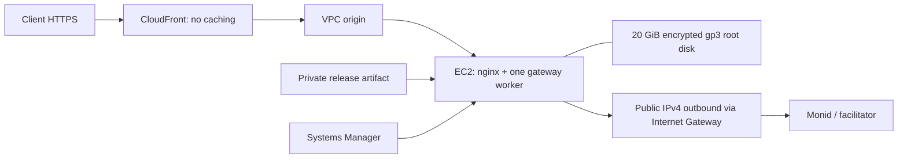

# AWS deployment and cutover guide

This guide describes the EC2 and CloudFront templates in `deploy/aws/`. It is a
reusable procedure, not a record of any running environment. Keep account names,
resource IDs, endpoints, deployment history, and verification results in a private
operator record. Supply deployment-specific values through protected configuration.

## Build automation and environment management

See the [AWS automation runbook](aws/README.md) for GitHub Actions, ECR images,
SSM deployment, and Parameter Store runtime configuration. Install the managed
runtime after the initial bootstrap; subsequent releases use immutable ECR digests.

## Resource naming

Choose a stable `ServiceName` before creating the stacks. The parameter controls
resource display names and repository/role names. Changing a display name does not
rename existing physical resources. Review replacement and attachment constraints
before changing names, particularly for attached CloudFront VPC origins.

## Architecture

- One `t3.small`, 2 vCPU / 2 GiB RAM, standard CPU credits to avoid surplus charges.
- One 20 GiB encrypted gp3 **root** volume. No additional data volume. Bind
  `/srv/monid/data` into the container at `/app/data`. This survives container
  replacement and instance stop/start. The volume is retained on termination;
  instance deletion/replacement is also retained in CloudFormation.
- CloudFront connects to the instance through a VPC origin. The instance has a
  public IPv4 address for outbound downloads and upstream calls, avoiding a NAT
  Gateway. Its application ingress is limited to CloudFront, with no SSH rule.
  After VPC-origin creation, replace the bootstrap prefix-list ingress with the
  AWS-managed CloudFront VPC-origin security group through the stack parameter.
- HTTPS uses the distribution's default `cloudfront.net` hostname. No ALB,
  API Gateway, NAT Gateway, Route 53 zone, or custom certificate is required.
- All request methods and viewer headers except `Host`, all query strings, and
  cookies are forwarded. Caching is disabled, including error caching. Raw
  access logs are disabled because payment headers and job tokens are sensitive.
- One instance and one worker are intentional. This is not a high-availability
  service. Root-disk retention is not a backup and does not cover AZ failure.

[VPC origins documentation](https://docs.aws.amazon.com/AmazonCloudFront/latest/DeveloperGuide/private-content-vpc-origins.html)
explains the private CloudFront path, Internet Gateway requirement, security
rules, and unsupported AZs. Use a supported AZ; `use1-az3` is excluded.

## Source and deployment boundary

Select an immutable, reviewed Git revision and record the deployed image digest
privately. Compare the source environment's schema and payment behavior before
importing its database; an image digest alone does not prove source parity.

Bootstrap with an empty disposable ledger and no production credentials. Keep
`X402_PAYMENT_ENABLED=true`; setting it to `false` disables payment enforcement
and must never be used as a maintenance switch.

A root-owned `/etc/monid/standby` marker makes nginx return `503` for everything
except `/health` and `/catalog`. This closes paid, job, discovery, and API
documentation routes. Verify the gate separately from application health: the
`paymentsReady` field only checks configuration presence. Initial provisioning
must not change the source service or copy production credentials and data.

## Deployment files

| File | Purpose |
| --- | --- |
| `aws/artifacts.json` | Private, encrypted, versioned S3 artifact bucket, retained on deletion |
| `aws/service.json` | Isolated VPC, instance role, EC2, root disk, CloudFront VPC origin and distribution |
| `aws/bootstrap.sh` | First boot only; install Docker/nginx, build immutable release, start standby |
| `aws/monid-gateway.service` | One container and one worker, bounded logs and memory, restart supervision |
| `aws/nginx.conf`, `aws/monid-proxy.conf` | Standby gate, local proxy, no paid-request retry or access logging |
| `aws/security.guard` | Narrow migration-specific encryption, retention, HTTPS and cache rules |

The container runs as UID/GID 10001, with a read-only root filesystem, dropped
capabilities, no-new-privileges, temporary `/tmp`, a 1,400 MiB memory limit, and
port 8000 bound only to host loopback. The data directory is writable only by
that UID. Administration uses Systems Manager with IMDSv2 required. No static
AWS credentials or wallet seeds are provisioned.

## Reproduce the standby deployment

1. Verify the intended AWS account and region with STS before making changes.
   Do not assume that local CLI credentials match another connected session.
2. Validate both JSON templates with `cfn-lint`. Validate `security.guard` with
   `cfn-guard validate --rules deploy/aws/security.guard --data <template>
   --output-format json`. These rules are scoped checks, not a broad compliance
   certification. Also run `bash -n deploy/aws/bootstrap.sh`.
3. Create a `CREATE` change set for `artifacts.json`. Wait for completion and
   inspect `DescribeEvents` scoped to that change set for validation failures.
   Execute only a passing change set within the authorized deployment scope.
4. Export the exact application revision using `git archive` into a clean
   temporary directory. Overlay `deploy/aws/` and add `SOURCE_REVISION`.
   Package only `Dockerfile`, `.dockerignore`, `pyproject.toml`, `uv.lock`,
   `README.md`, `LICENSE`, `THIRD_PARTY_NOTICES.md`, `gateway/`, `scripts/`,
   `deploy/aws/`, and `SOURCE_REVISION`. Do not package the working directory,
   `.env`, `.git`, runtime data, local documents, or a virtual environment.
5. Upload the archive to the private artifact bucket under `releases/<revision>/`.
   Record its SHA-256 privately. Upload only through an authenticated session
   for the intended account.
6. Create a `CREATE` change set for `service.json` with the artifact bucket/key,
   archive SHA-256, full source revision, a verified AL2023 x86_64 AMI, a supported
   AZ, and the regional CloudFront origin-facing prefix-list ID. Use
   `CAPABILITY_IAM`. Leave `CloudFrontServiceSecurityGroupId` empty initially.
7. Inspect validation events and execute. First boot downloads the archive,
   checks its hash, builds the image using `uv.lock`, and starts the service.
   CloudFormation completion does not by itself prove the app is healthy;
   inspect bootstrap and service state through SSM.
8. Read `PublicUrl` from stack outputs. Through SSM, change only
   `PUBLIC_BASE_URL` in `/etc/monid/gateway.env` to that URL and restart the
   standby service. Keep `/etc/monid/standby` present and credentials absent.
9. Discover the AWS-created `CloudFront-VPCOrigins-Service-SG` in this VPC.
   Update `CloudFrontServiceSecurityGroupId` through a validated change set,
   preserving all other parameters. This closes the public prefix-list path.
10. Verify `/health` and `/catalog` through HTTPS; all paid, job, and discovery
    routes must return 503 with no cache hit. Check direct-origin ingress is
    blocked. Restart the container and verify the same SQLite file is preserved.
    Check the source service health without executing a paid tool.

The AMI and upstream Docker base-image tags are resolved at build time. The
source archive is hash-verified; record the built Docker image ID for recovery.
For an exact binary rollback, retain/export that built image rather than assuming
that a later rebuild from floating base tags is identical.

## Conditions before switching production traffic

Do not remove the standby marker merely because HTTP health is green.

1. **Request deadlines:** The application bounds tool/job requests with
   `REQUEST_DEADLINE_SECONDS` (100 seconds by default), below the template's
   nginx/CloudFront timeouts of 115/120 seconds. Signed requests exceeding
   concurrency capacity are rejected before invoice claiming. Keep
   `RUN_WAIT_SECONDS=0` for prompt asynchronous job handoff. Validate these
   cancellation and admission behaviors with the selected release before enabling
   paid traffic. A deadline does not undo an upstream side effect; preserve unknown
   states and retry only the original signed invoice, never a new execution.
2. **Source compatibility:** identify the source service schema and deployment
   revision; compare it with the AWS application and durable invoice schema.
   Take a backup before any schema initialization/migration against real data.
3. **Credential and merchant parity:** securely provision the existing Monid
   workspace key, selected-network receiver, issuer, facilitator, pricing, exclusions,
   and source tag. Never place secret values in Git, user data, stack parameters,
   terminal output, or a local migration report. Check upstream balance and the
   facilitator independently; `/health` only checks configuration presence.
4. **Freeze and copy:** close new paid admissions on the source service, drain in-flight
   executions/settlements, and freeze job polling writes. Reconcile all uncertain
   payments. Use SQLite's online backup API or a fully stopped consistent copy;
   do not copy only the database file while WAL/journal writes can occur. Transfer
   all run and invoice state, job tokens, and catalog privately. Verify integrity,
   schema, row/state counts, and file ownership on AWS before opening it.
5. **Recovery:** take an encrypted backup outside the EC2 disk, restore it into an
   isolated directory, and prove integrity and recovery. Configure backup
   retention, disk monitoring, and actionable health alerts before production.
   The separate [operations stack](aws/operations/README.md) provides a private
   backup bucket, daily SQLite snapshots and basic alarms. Verify its installation,
   off-host restore and notification setup independently of release artifacts.
6. **Routing:** a provider-generated hostname generally cannot be reassigned to
   CloudFront. Decide the production hostname and update clients/Hub registration
   deliberately. Preserve old job polling behavior during the transition. Never
   leave both independent databases open for paid writes.

The application has durable invoices, atomic execution claims, saved
responses, and fail-closed uncertain states. That improves crash recovery but
is not a license to run two independent production ledgers. Keep a single writer.

## Rollback and costs

Before AWS accepts writes, rollback is keeping the source service active and the new
service closed. After AWS accepts writes, first close and drain AWS, reconcile
unknown transactions, and migrate its newest state back; never reopen an old
source ledger unchanged. Retain the old service until the migration is verified.

EC2, its allocated root EBS volume, and public IPv4 are separately billable even
while paid routes are closed. CloudFront/S3 requests and transfer may add usage
charges. Standard CPU credits avoid t3 surplus-credit charges, but sustained CPU
load can be throttled. No additional data disk, ALB, or NAT Gateway is provisioned.
Estimate costs for the selected region and instance size using current AWS pricing;
include storage, IPv4, registry, requests, transfer, backups, taxes, and credits.

Termination protection and retention intentionally preserve the instance/root
volume and artifact bucket. Deleting a stack will not automatically stop all
charges. Retire them explicitly after confirming no needed ledger or release is
lost. Stopping the instance stops compute charges but EBS storage remains billed.
